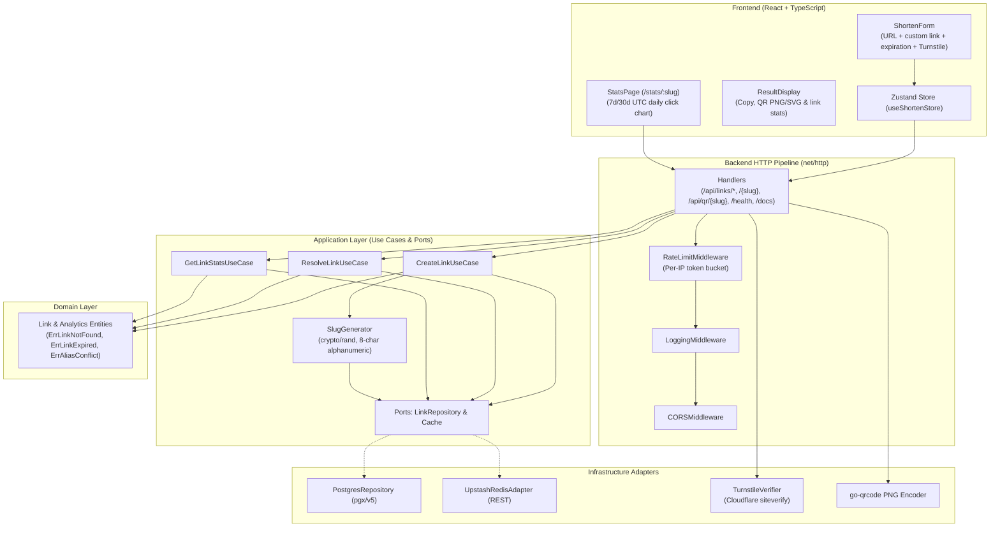

# Architecture Overview

MicroURL is structured as a monorepo with a **Go backend** following **Hexagonal Architecture** (Ports & Adapters) and a **TypeScript + React frontend**.

---

## System Diagram

---

## Backend Layers (Hexagonal Architecture)

1. **Domain (`backend/internal/domain/`)**
   - Contains the `Link` entity (`ID`, `Slug`, `OriginalURL`, `CreatedAt`, `ExpiresAt`, `ClickCount`, `IsExpired()`, `EffectiveStatus()`), `LinkStats` / `DailyClickCount`, destination URL and custom alias validation, and domain sentinel errors.
   - Zero dependencies on HTTP, SQL, or external SDKs.
2. **Application (`backend/internal/application/`)**
   - Defines outbound ports (`LinkRepository` and `Cache`) and orchestrates business workflows:
     - `CreateLinkUseCase`: validates custom aliases (3–64 chars, reserved-route block) or generates a random 8-character slug with collision retry, persists the `Link` via `LinkRepository`, and warms `Cache`.
     - `ResolveLinkUseCase`: checks `Cache` (`link:slug:<slug>`) first, falls back to `LinkRepository` on cache miss/unavailability, enforces `IsExpired()` (evicting stale keys from cache), optionally increments UTC daily and total click counters (`CountClick`), and populates cache on DB hits.
     - `GetLinkStatsUseCase`: loads link metadata and zero-filled `7d` / `30d` UTC daily click series.
3. **Infrastructure (`backend/internal/infrastructure/`)**
   - **HTTP (`http/`)**: `net/http` `ServeMux` router wrapped with per-IP rate limiting, request logging, and CORS; serves JSON APIs, `302` redirects, PNG QR codes, `/health`, `/openapi.json`, and Scalar UI (`/docs`).
   - **Persistence (`persistence/`)**: `PostgresRepository` backed by `*sql.DB` (`pgx/v5/stdlib` with `simple_protocol` and connection pooling) managing `links` and `link_click_daily`.
   - **Cache (`cache/`)**: `UpstashRedisAdapter` storing JSON-serialized `Link` structs via Upstash's Redis REST API with configurable TTL (`CACHE_TTL`). Cache failures or missing credentials are treated as non-fatal optimizations and fall back to PostgreSQL.
   - **Security (`security/`)**: `TurnstileVerifier` validating tokens against Cloudflare Turnstile (`TURNSTILE_SECRET_KEY`), with an explicit development-only bypass when `APP_ENV=development` and no secret key is configured.

---

## Request Lifecycles

### 1. Short Link Creation (`POST /api/links`)
1. `RateLimitMiddleware` uses `ClientIPResolver` (which only honors `X-Forwarded-For`/`X-Real-IP` when the direct peer matches `TRUSTED_PROXIES`) to check the client's token bucket.
2. `Handlers.CreateLink` enforces a 16 KiB body cap, decodes JSON, validates the destination via `domain.ValidateDestinationURL` (public `http`/`https`, max 2048 chars, no embedded credentials), validates optional `custom_slug` and future RFC3339 `expires_at`, then verifies `captcha_token` via `TurnstileVerifier` using the same resolved client IP.
3. `CreateLinkUseCase` re-enforces domain validation, accepts a custom alias (`409 Conflict` if taken) or generates an 8-character unique slug (with collision retry), inserts the record into PostgreSQL, and caches it in Upstash Redis.
4. Returns `201 Created` with `short_url` and `qr_code_url`.

### 2. Link Resolution (`GET /{slug}`)
1. `ResolveLinkUseCase` (`CountClick: true`) looks up `link:slug:{slug}` in Upstash Redis.
2. On cache hit, checks `IsExpired()` (evicting and returning `410 Gone` if expired), records the UTC daily click in PostgreSQL, and redirects with `302 Found`.
3. On cache miss or cache error, queries PostgreSQL, validates expiration status, repopulates Upstash Redis, records the click, and redirects with `302 Found`.

### 3. Analytics & QR Generation (`GET /api/links/{slug}/stats`, `GET /api/qr/{slug}`)
1. `GET /api/links/{slug}/stats` returns zero-filled `7d` or `30d` UTC daily click analytics.
2. `GET /api/qr/{slug}` resolves the slug with `CountClick: false` so QR generation never inflates click metrics, returning a 256×256 PNG with `Cache-Control: public, max-age=3600`.
